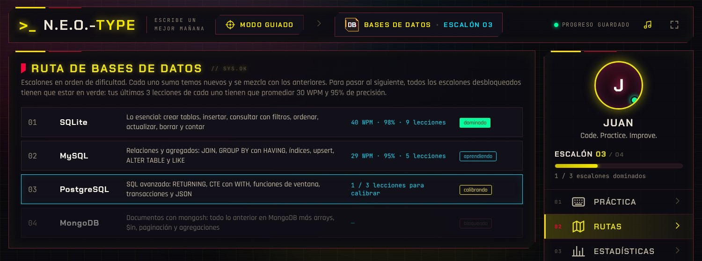
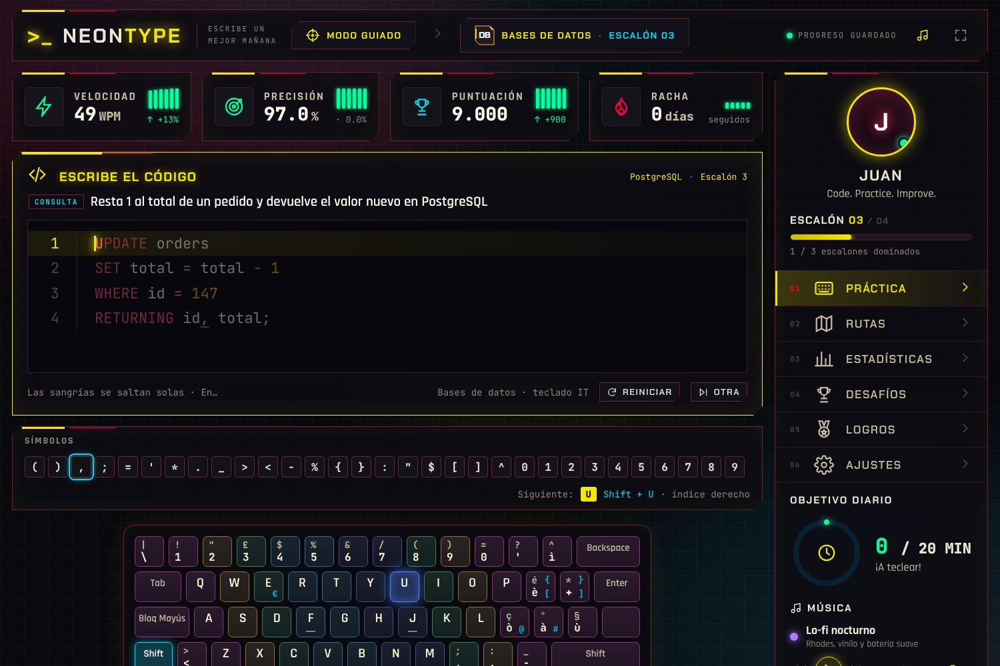

<div align="center">

# N.E.O.-type

**Mecanografía para programadores.** Aprendé a teclear código real más rápido: funciones, clases, enums y algoritmos
de 7 lenguajes, con un sistema adaptativo que te entrena cada símbolo hasta dominarlo.


[](https://github.com/juancruzgentile/N.E.O.-type/actions/workflows/ci.yml)
[](https://github.com/juancruzgentile/N.E.O.-type/actions/workflows/codeql.yml)


</div>

## ¿Qué es?

Los tutores de mecanografía clásicos entrenan palabras. Al programar, lo que frena son los símbolos: `[] {} () => -> :: != &&`.
N.E.O.-type te hace tipear **código real** —nunca se ejecuta, es solo para entrenar los dedos— y cada fragmento viene con
un título que explica qué hace.

- **7 lenguajes**: Python, JavaScript, TypeScript, Java, C#, Go y Rust.
- **5 rutas Trainee**: bases de datos (SQLite → MySQL → PostgreSQL → MongoDB), terminal Linux (Ubuntu/Mint → Debian →
  Fedora → CachyOS → Arch), HTML, CSS y formatos (`.env`, `requirements.txt`, JSON, `package.json`, YAML, Markdown).
- **Modo guiado adaptativo**: empezás con `(` y `)`. Cada símbolo nuevo se practica con ejercicios dirigidos y después con
  funciones reales que lo usan. El símbolo más débil es el *foco* y aparece en todas las lecciones.
- **Desbloqueo exigente**: la siguiente etapa se abre solo cuando todos tus símbolos superan el mínimo de pulsaciones,
  la velocidad objetivo y la precisión mínima (configurables).
- **Código infinito**: ~40 conceptos × 22 entidades de dominio × variantes por lenguaje → cientos de funciones distintas.
- **4 teclados físicos**: italiano, inglés (EE. UU.), español (España) y español (Latinoamérica), con la tecla, el dedo y
  los modificadores (Shift / AltGr) del siguiente carácter.
- **Tu teclado real**: si escribís un símbolo con otra tecla o modificador, la app lo aprende sola mientras
  practicás. También podés calibrarlo de una vez desde Ajustes.
- **Modo libre y desafíos**: sprints de 30/60/120 s y "precisión perfecta", con récords.
- **Estadísticas**: evolución de velocidad y precisión, mapa de calor del teclado, calendario de práctica.
- **Música generativa**: 7 estaciones (lo-fi, lluvia, synthwave, espacio, zen, jazz y foco) sintetizadas en vivo con
  Web Audio, sin archivos ni licencias de por medio. Nunca suenan exactamente igual. También podés cargar tus propias
  canciones: quedan guardadas en el navegador.
- **Interfaz viva**: teclado flotante, fondo de partículas que late con la música, chispas de la tecla al código,
  brillo según tu racha de aciertos y animación al desbloquear cada símbolo. Todo se apaga desde Ajustes y respeta
  la preferencia del sistema de reducir movimiento.
- **Logros y temas**: 27 logros con insignias y 6 temas de color (Cyber, Neón, Synthwave, Matrix, Tokio noche y Claro),
  con una estética cyberpunk que nunca toca la legibilidad del código.
- **Tu perfil**: pantalla de inicio con efecto de cartel de neón, tu nombre y tu foto (o uno de los 12 avatares incluidos).
- **Tutorial de bienvenida**: un mensaje inicial y un recorrido corto que señala lo básico de la pantalla de
  práctica. Se maneja con el teclado y se puede repetir desde Ajustes.
- **100 % offline**: el build es un único `NeonType.html` que se abre con doble clic. El progreso queda en tu navegador.

<table>
  <tr>
    <td></td>
    <td></td>
  </tr>
  <tr>
    <td align="center">Elegí un lenguaje</td>
    <td align="center">Ruta de símbolos según tu teclado</td>
  </tr>
  <tr>
    <td></td>
    <td></td>
  </tr>
  <tr>
    <td align="center">Estadísticas y mapa de calor</td>
    <td align="center">Logros</td>
  </tr>
</table>


<p align="center"></p>

## Empezar

Requiere [Node.js](https://nodejs.org) 20.19 o superior dentro de la rama 20, o 22.12 o superior (lo exige Vite 7).

```bash
git clone https://github.com/juancruzgentile/N.E.O.-type.git
cd N.E.O.-type
npm ci             # instala exactamente lo del lockfile, sin scripts de instalación
npm run build      # genera NeonType.html, autocontenido
```

Abrí `NeonType.html` con doble clic. Para desarrollar con recarga en caliente: `npm run dev`.

Atajos para quien no quiera usar la terminal:

| | Windows | Linux |
| --- | --- | --- |
| Construir | `construir.bat` | `./construir.sh` |
| Abrir | `iniciar.bat` | `./iniciar.sh` |
| Desarrollo | `desarrollo.bat` | `./desarrollo.sh` |

### Scripts

| Comando | Qué hace |
| --- | --- |
| `npm run dev` | Servidor de desarrollo |
| `npm run build` | Typecheck + build de un solo archivo (`dist/index.html` → `NeonType.html`) |
| `npm run check` | Genera miles de fragmentos y verifica que ninguno use símbolos fuera de la ruta de su lenguaje |
| `npm test` | Corre todas las pruebas de abajo |
| `npm run test:logic` | Progreso, desbloqueos, logros, resaltado y canciones guardadas |
| `npm run test:regression` | Tests de regresión: motor de sesiones, copias de seguridad, conceptos, música y modo calmo |
| `npm run test:security` | Tests de validación de datos y de la Content Security Policy del build |
| `npm run test:e2e` | La app en un Chromium real (requiere `npm run build` y, una vez, `npx playwright-core install --only-shell chromium`) |
| `npm run audit` | Auditoría de vulnerabilidades y firmas de las dependencias |

## Cómo funciona el modo guiado

1. Cada pulsación registra el tiempo desde la anterior y si fue correcta al primer intento.
2. Por símbolo se guarda una media exponencial del tiempo y la precisión de los últimos 50 intentos.
3. Un símbolo está **dominado** cuando tiene el mínimo de muestras, alcanza la velocidad objetivo y supera la precisión mínima.
4. Con todos los símbolos desbloqueados dominados, se abre la siguiente etapa de la ruta del lenguaje.
5. El generador elige fragmentos que usen **solo** símbolos desbloqueados y que contengan el símbolo foco.

## Rutas Trainee

Además de los lenguajes, hay rutas para las herramientas que se usan todos los días. En lugar de símbolos, avanzan por
**escalones** ordenados por dificultad:

| Ruta | Escalones |
| --- | --- |
| Bases de datos | SQLite → MySQL → PostgreSQL → MongoDB |
| Terminal Linux | Ubuntu / Mint → Debian → Fedora → CachyOS → Arch Linux |
| HTML | Estructura → Listas y tablas → Formularios → Semántica → Head y recursos |
| CSS | Selectores y color → Modelo de caja → Flexbox → Grid → Responsive → Variables y animación |
| Formatos | .env → requirements.txt → JSON → package.json → YAML → Markdown |

1. Cada escalón suma temas nuevos. En bases de datos y terminal, lo aprendido antes se practica también en el motor o la
   distribución nueva (un upsert se escribe distinto en SQLite, MySQL, PostgreSQL y MongoDB; instalar un paquete,
   distinto en Ubuntu, Fedora y Arch).
2. Cerca de dos tercios de las lecciones van al escalón más débil y el resto repasa los anteriores.
3. Un escalón está **dominado** cuando tus últimas 3 lecciones en él promedian la velocidad objetivo y la precisión mínima.
4. Con todos los escalones desbloqueados dominados, se abre el siguiente.
5. En el modo libre se elige el motor de base de datos o la distribución con un selector.

<table>
  <tr>
    <td></td>
    <td></td>
  </tr>
</table>

## Estructura

```
src/
├── data/
│   ├── curriculum.ts    # orden de desbloqueo de símbolos por lenguaje
│   └── layouts.ts       # teclados IT / US / ES / LATAM y ajuste al teclado real del usuario
├── gen/
│   ├── base.ts          # vocabulario de dominio, nombres (snake/camel/Pascal), español
│   ├── concepts.ts      # conceptos y sus títulos
│   ├── lang/            # un generador por lenguaje
│   ├── drills.ts        # ejercicios de símbolos
│   └── index.ts         # elige fragmentos según los símbolos permitidos
├── tracks/
│   ├── types.ts         # estructura de una ruta Trainee (escalones, temas, variantes)
│   ├── sql.ts           # bases de datos: SQLite, MySQL, PostgreSQL y MongoDB
│   ├── linux.ts         # terminal por distribución
│   ├── web.ts           # HTML y CSS
│   ├── formats.ts       # .env, requirements.txt, JSON, package.json, YAML y Markdown
│   └── index.ts         # registro de rutas y elección de ejercicios
├── engine/
│   ├── session.ts       # procesa cada pulsación
│   └── stats.ts         # estadísticas, foco, desbloqueo, elección de lección
├── audio/
│   ├── music.ts         # motor de música generativa (instrumentos, estaciones, secuenciador)
│   └── tracks.ts        # canciones del usuario en IndexedDB
├── fx/fx.ts             # efectos sobre el DOM con Web Animations API (sin re-render de React)
├── sanitize.ts          # validación estricta de datos importados y guardados
└── components/          # interfaz en React
```

### Rendimiento

En una app de mecanografía la latencia importa más que cualquier efecto. Por eso las animaciones de cada pulsación
se aplican directo sobre el DOM, el fondo se dibuja en un canvas limitado a ~30 fps que se pausa con la pestaña
oculta, y los movimientos continuos usan solo `transform` y `opacity`. Los ciclos de las auroras (31, 43 y 59 s) y del
teclado (13, 17 y 23 s) son números primos para que las capas casi nunca vuelvan a coincidir.

## Privacidad y seguridad

- **100 % local**: sin servidor, sin cuentas y sin telemetría. El progreso, el perfil y tus canciones quedan solo en
  tu navegador.
- **Sin red**: la Content Security Policy del build prohíbe cualquier conexión, así que ningún dato puede salir de
  tu equipo.
- **Datos validados**: las copias de seguridad importadas se reconstruyen campo por campo con una lista blanca.
- **Cadena de suministro cuidada**: dependencias mínimas y fijadas, instalación sin scripts, auditoría, CodeQL y
  Dependabot.

Detalles y cómo reportar un problema: [SECURITY.md](SECURITY.md). Historial de cambios: [CHANGELOG.md](CHANGELOG.md).

## Contribuir

Las contribuciones son bienvenidas: nuevos lenguajes, conceptos, teclados o mejoras de la interfaz.
Mirá [CONTRIBUTING.md](CONTRIBUTING.md).

## Licencia

[MIT](LICENSE) © Juan Cruz Gentile. Las dependencias y fuentes incluidas tienen sus propias licencias: ver
[THIRD_PARTY_NOTICES.md](THIRD_PARTY_NOTICES.md).

Los nombres de los lenguajes son marcas de sus titulares y se usan solo para identificarlos; los emblemas son diseños
propios. La idea de la práctica adaptativa está inspirada en [keybr.com](https://www.keybr.com), pero N.E.O.-type es
una implementación independiente que no reutiliza su código ni su diseño.
